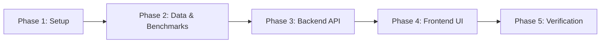

# Sepsis Early-Warning System: Project Architecture & Execution Plan

## 1. Project Overview & Model Understanding

Based on the inspection of [`README.md`](file:///c:/Users/Abhinay/Desktop/data%20science%20project/README.md) and [`sepsis-model.onnx`](file:///c:/Users/Abhinay/Desktop/data%20science%20project/sepsis-model.onnx), the project revolves around **asep-sepsis-onnx**, an ONNX-exported LightGBM model developed for **Datathon 2026** (derived from the PhysioNet/CinC Challenge 2019 dataset).

### Key Model Characteristics
- **Task**: Tabular classification predicting sepsis onset **6 hours before clinical manifestation**.
- **Model Size & Runtime**: 385 KB ONNX model running in-process on CPU without GPU overhead.
- **Input Contract**:
  - Tensor Name: `input`
  - Shape: `[N, 9]` (type `float32`)
  - Feature Order:
    1. `age` (years)
    2. `hoursSinceAdmission` (hours)
    3. `HR` (Heart Rate, beats/min)
    4. `Temp` (Temperature, °C)
    5. `Resp` (Respiratory Rate, breaths/min)
    6. `SBP` (Systolic Blood Pressure, mmHg)
    7. `DBP` (Diastolic Blood Pressure, mmHg)
    8. `O2Sat` (Oxygen Saturation, %)
    9. `EtCO2` (End-Tidal Carbon Dioxide, mmHg)
- **First-Class Missing Values (`NaN`)**:
  - The model was specifically trained with `NaN` handling enabled. If a sensor is unavailable (e.g., no capnograph for `EtCO2`), the value **must be `NaN`**, never `0` or arbitrary imputations.
- **In-Graph Mean Arterial Pressure (MAP)**:
  - The ONNX computational graph derives `MAP = DBP + (SBP - DBP) / 3` internally from features 6 and 7, ensuring continuous mathematical parity.
- **Output Contract**:
  - Tensor Name: `riskScore` (shape `[N]`, range `[0.0, 1.0]`)
  - **Calibrated Risk Tiers**:
    - **Low Risk (`< 0.3`)**: Observed sepsis rate ~0.68%
    - **Medium Risk (`0.3 – 0.6`)**: Observed sepsis rate ~1.80%
    - **High Risk (`≥ 0.6`)**: Observed sepsis rate ~6.66% (~10× relative risk compared to Low)

---

## 2. System Architecture

```mermaid
flowchart TD
    subgraph Data & Evaluation Engine
        A[Clinical Knowledge Base & PhysioNet Distributions] --> B[Synthetic Clinical Data Generator]
        B --> C[Synthetic Test Dataset (CSV)]
        C --> D[ONNX Model Evaluation Pipeline]
        D --> E[Metrics & Benchmark Store\nAUROC, AUPRC, Confusion Matrix, Tiers]
    end

    subgraph Backend API (Python / Flask)
        F[Flask REST API Service]
        D_Model[sepsis-model.onnx via onnxruntime] --> F
        E --> F
        F --> G[POST /api/predict]
        F --> H[GET /api/evaluation-metrics]
        F --> I[POST /api/generate-dataset]
    end

    subgraph Frontend Application (Responsive Clinical UI)
        J[Web UI / Clinical Triage Interface]
        G <--> J
        H --> J
        I --> J
        J --> K[Tab 1: Bedside Triage & Live Prediction]
        J --> L[Tab 2: Model Accuracy & ROC/PR Dashboard]
        J --> M[Tab 3: Synthetic Data Inspector & Batch Tester]
    end
```

---

## 3. Detailed Component Plan

### Component A: Physiologically Grounded Synthetic Data Generation
Since actual patient ICU records are not present locally and cannot be distributed without HIPAA/PhysioNet credentials, we will create a generator (`generate_test_data.py`) adhering to clinical ICU distributions:
1. **Non-Septic Cohort (Control Group, ~92.7% of samples)**:
   - Normal physiological variations:
     - HR: $60 - 95\text{ bpm}$
     - Temp: $36.5 - 37.3^\circ\text{C}$
     - Resp: $12 - 18\text{ breaths/min}$
     - SBP: $110 - 135\text{ mmHg}$, DBP: $70 - 85\text{ mmHg}$
     - O2Sat: $96 - 100\%$
     - EtCO2: $35 - 45\text{ mmHg}$ or `NaN`
   - Realistic ICU stay durations and diverse age distributions (18–90 years).
2. **Pre-Septic / Septic Cohort (~7.3% matching PhysioNet prevalence)**:
   - Follows **SIRS** and **Sepsis-3** diagnostic criteria:
     - Tachycardia: $\text{HR} > 100 - 140\text{ bpm}$
     - Fever ($> 38.3^\circ\text{C}$) or Hypothermia ($< 36.0^\circ\text{C}$)
     - Tachypnea: $\text{Resp} > 22 - 36\text{ breaths/min}$
     - Hypotension / Septic Shock: $\text{SBP} < 95\text{ mmHg}$, $\text{MAP} < 65\text{ mmHg}$
     - Hypoxia: $\text{O2Sat} < 92\%$
     - Abnormal EtCO2 ($< 32\text{ mmHg}$ indicating metabolic acidosis/hyperventilation).
3. **Realistic Sensor Dropout Profiles**:
   - Facilities with no capnograph: `EtCO2 = NaN` (~80% missingness).
   - Pulse oximeter disconnections or intermittent blood pressure dropouts (~10–15% missingness).
4. **Outputs**:
   - `data/synthetic_clinical_test.csv` (e.g., 2,000–5,000 patient-hour observations with ground truth `SepsisLabel`).

---

### Component B: Model Accuracy & Validation Benchmark Engine
A dedicated validation script (`evaluate_model.py`) will load `sepsis-model.onnx` and score the synthetic dataset:
1. **Metrics Calculated**:
   - **AUROC (Area Under ROC Curve)**: Evaluates overall discrimination ability.
   - **AUPRC (Area Under Precision-Recall Curve)**: The primary metric for severe class imbalance.
   - **Confusion Matrix**: True Positives, False Positives, True Negatives, False Negatives at thresholds 0.3 and 0.6.
   - **Clinical Metrics**: Sensitivity / Recall, Specificity, Positive Predictive Value (PPV), Negative Predictive Value (NPV), F1-Score.
   - **Calibration Analysis**: Empirical sepsis prevalence within Low (<0.3), Medium (0.3–0.6), and High (≥0.6) predicted risk tiers.
   - **Baseline Rule Comparison**: Compare the ONNX model against heuristic scores (vitals-only qSOFA and SIRS).
2. **Artifacts Output**:
   - Pre-computed curve points (FPR, TPR, Precision, Recall thresholds) exported to `data/model_metrics.json` for instant visualization in the frontend.

---

### Component C: Python Backend API
Implemented using Flask (`app.py`), integrating `onnxruntime`:
1. **Model Loader Service**:
   - Initializes `ort.InferenceSession("sepsis-model.onnx")` once at startup for sub-millisecond predictions.
   - Handles input schema verification and `NaN` conversion for omitted fields.
2. **API Endpoints**:
   - `POST /api/predict`:
     - Payload: JSON object with the 9 features (null/omitted mapped to `NaN`).
     - Response: Computed MAP, raw `riskScore`, risk tier (`Low`, `Medium`, `High`), and clinical guidance.
   - `GET /api/metrics`:
     - Returns pre-calculated ROC curve, PR curve, confusion matrix, and tier statistics.
   - `POST /api/generate-data`:
     - Allows regenerating test data with customizable patient count and viewing updated metrics dynamically.
   - `GET /`:
     - Serves the integrated frontend application.

---

### Component D: Interactive Clinical Frontend
A clean, responsive, hospital-grade dashboard built with modern HTML5, Tailwind CSS, and Chart.js:
1. **Bedside Triage & Live Prediction Form**:
   - Form inputs for all 9 vitals with units and normal reference ranges.
   - "Leave as Unknown" checkboxes or empty states automatically mapped to `NaN`.
   - **Dynamic MAP Display**: Live calculation of Mean Arterial Pressure ($DBP + \frac{SBP - DBP}{3}$).
   - **One-Click Clinical Presets**:
     - *Normal Healthy Vitals*
     - *Severe Sepsis / Septic Shock*
     - *Primary Care / Minimal Equipment (EtCO2 absent)*
     - *Elderly Hypothermic Sepsis*
   - **Visual Risk Meter & Alert Cards**:
     - Color-coded gauge: Green (Low, <0.3), Amber (Medium, 0.3–0.6), Red (High, ≥0.6).
     - Clinical action recommendations (e.g., "Check blood lactate", "Initiate IV fluids", "Continue routine monitoring").
     - Abnormal vital badges highlighting vitals outside standard ranges.
2. **Model Accuracy & Validation Dashboard**:
   - Interactive **ROC Curve** and **Precision-Recall Curve** charts.
   - **Confusion Matrix** visualization.
   - **Risk Tier Calibration Bar Chart** comparing predicted vs observed incidence.
   - Comparison card showing model superiority over classical qSOFA/SIRS scoring.
3. **Synthetic Dataset Explorer & Batch Testing**:
   - Table view of sample patients from the synthetic test set.
   - Ability to click any row in the dataset to load it directly into the triage form.
   - Summary statistics of the synthetic cohort (class ratio, missingness percentages).

---

## 4. Step-by-Step Implementation Roadmap



1. **Phase 1: Environment & Dependency Setup**
   - Install `onnxruntime` into the Python environment.
   - Verify model loading and test single inference against the contract specified in `README.md`.
2. **Phase 2: Synthetic Clinical Data Generator & Evaluator**
   - Implement `generate_test_data.py` to synthesize clinical records with SIRS/Sepsis distributions and realistic missingness.
   - Implement `evaluate_model.py` to compute AUROC, AUPRC, confusion matrices, and tier calibration.
   - Generate test dataset and persist baseline metrics.
3. **Phase 3: Flask Backend API**
   - Create `app.py` with endpoints for prediction, metrics retrieval, and data generation.
   - Implement input validation and in-graph MAP checks.
4. **Phase 4: Clinical Frontend Dashboard**
   - Develop `templates/index.html` and modern clinical UI components.
   - Integrate Chart.js for ROC/PR curves and calibration charts.
   - Implement live bedside form, dynamic MAP calculator, and presets.
5. **Phase 5: Verification & End-to-End Testing**
   - Test extreme cases (all vitals present, partial vitals, missing EtCO2, out-of-range vitals).
   - Verify parity with README metrics (high risk tier ~10x lift, NaN handling).
   - Deliver launch instructions.

---

## 5. Technology Stack Summary

| Layer | Technology | Rationale |
|---|---|---|
| **Model Runtime** | `onnxruntime` (Python) | Direct, high-performance CPU inference on `sepsis-model.onnx` (<1 ms latency). |
| **Backend API** | Python `Flask` & `Flask-CORS` | Lightweight, already installed in environment, zero extra server baggage. |
| **Data & Metrics** | `numpy`, `pandas`, `scikit-learn` | Standard scientific stack for PhysioNet distribution modeling and metric calculations. |
| **Frontend UI** | HTML5, Tailwind CSS, Vanilla JS, Chart.js | Hospital dashboard aesthetic, responsive, zero complex node build steps needed. |
